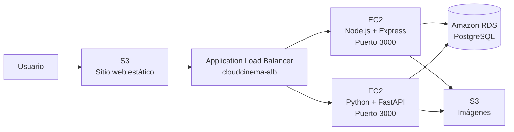

# CloudCinema

## Manual técnico de la Práctica 1

CloudCinema es una aplicación web de cartelera de películas desarrollada para demostrar el uso integrado de distintos servicios de AWS. Con mi grupo decidimos separar el frontend, los backends, las imágenes y la base de datos para que cada parte tuviera una responsabilidad clara. También implementamos dos APIs equivalentes detrás de un balanceador de carga, de modo que la aplicación pueda continuar funcionando si uno de los servidores deja de estar disponible.

## Datos de los estudiantes

| Nombre completo | Carnet |
| --- | --- |
| Hernán Ricardo Ávila Castillo | 9516085 |
| Javier Andrés Monterroso García | 202102140 |
| Daved Abshalon Ejcalon Chonay | 202105668 |

## Arquitectura utilizada

Con mi grupo hicimos el frontend con HTML, CSS y JavaScript, y lo publicamos como un sitio web estático en Amazon S3. Desde el navegador, el frontend envía todas las solicitudes de la API al DNS público del Application Load Balancer. De esta forma no depende de la dirección IP de una instancia específica.

El balanceador distribuye las solicitudes entre dos instancias EC2. En una ejecutamos la API desarrollada con Node.js y Express, y en la otra la API desarrollada con Python y FastAPI. Ambas escuchan en el puerto `3000`, ofrecen los mismos endpoints y devuelven respuestas con el mismo formato. Los dos backends comparten una base de datos PostgreSQL alojada en Amazon RDS y utilizan un segundo bucket de S3 para guardar fotografías de perfil y pósteres de películas.



Todos los recursos se configuraron en la región de Ohio, `us-east-2`. Las instancias EC2, el balanceador y RDS se encuentran dentro de la misma VPC, mientras que los buckets de S3 pertenecen a la misma región. La comunicación interna se controla con grupos de seguridad para evitar que RDS o los puertos de las APIs queden expuestos directamente a Internet.

## Gestión de identidad y acceso

Con mi grupo decidimos crear usuarios de IAM distintos para separar las tareas de infraestructura, base de datos y frontend. Cada usuario tiene permisos sobre los servicios que necesita administrar y no comparte credenciales con las aplicaciones desplegadas.

| Usuario de IAM | Políticas asignadas | Uso dentro del proyecto |
| --- | --- | --- |
| `P1_BACKEND` | `AmazonEC2FullAccess` y `ElasticLoadBalancingFullAccess` | Administración de las instancias EC2, el balanceador y el grupo de destino de los backends. |
| `P1_BD` | `AmazonRDSFullAccess` | Creación y administración de la instancia PostgreSQL en RDS. |
| `P1_FRONTEND` | `AmazonS3FullAccess` | Administración de los buckets del sitio web y de imágenes. |


La separación también se puede observar en las políticas asignadas a cada usuario.

| Backend | Base de datos | Frontend |
| --- | --- | --- |
|  |  |  |

Para las aplicaciones que corren en EC2 creamos el rol `cloudcinema-backend-ec2-role`. El rol confía en el servicio EC2 y está asociado a las dos instancias backend. Gracias a esto, Node.js y FastAPI obtienen credenciales temporales de AWS automáticamente y no necesitamos guardar claves de acceso permanentes en sus archivos `.env`.


Al rol le asignamos la política `CloudCinemaImagesS3Policy`. Esta política permite consultar el bucket y leer o subir objetos únicamente dentro de `Fotos_Perfil` y `Fotos_Peliculas`. No concede acceso administrativo a otros buckets ni permite eliminar objetos.

<details>
<summary>Política utilizada por el rol de las instancias EC2</summary>

```json
{
  "Version": "2012-10-17",
  "Statement": [
    {
      "Sid": "ListCloudCinemaImages",
      "Effect": "Allow",
      "Action": [
        "s3:ListBucket",
        "s3:GetBucketLocation"
      ],
      "Resource": "arn:aws:s3:::practica1-images-g3-594775506039"
    },
    {
      "Sid": "ManageCloudCinemaImages",
      "Effect": "Allow",
      "Action": [
        "s3:GetObject",
        "s3:PutObject"
      ],
      "Resource": [
        "arn:aws:s3:::practica1-images-g3-594775506039/Fotos_Perfil/*",
        "arn:aws:s3:::practica1-images-g3-594775506039/Fotos_Peliculas/*"
      ]
    }
  ]
}
```

</details>

## Almacenamiento en Amazon S3

Hicimos dos buckets porque el código del sitio y las imágenes cumplen funciones diferentes. `practica1-web-g3-594775506039` contiene los archivos HTML, CSS y JavaScript del frontend. Tiene habilitado el alojamiento de sitios web estáticos y utiliza `index.html` como documento de inicio. Su dirección es:

<http://practica1-web-g3-594775506039.s3-website.us-east-2.amazonaws.com>

El bucket `practica1-images-g3-594775506039` almacena las imágenes que utiliza la aplicación. Dentro de este bucket separamos los archivos en los prefijos `Fotos_Perfil/` y `Fotos_Peliculas/`. Las imágenes tienen lectura pública para poder mostrarse en el navegador, mientras que la escritura se realiza desde las APIs mediante el rol de EC2.


La política del bucket web permite únicamente `s3:GetObject` sobre sus archivos publicados. Las ACL se mantienen deshabilitadas y el acceso se controla mediante políticas de bucket. Aplicamos el mismo criterio de lectura pública al contenido gráfico porque el frontend necesita descargar directamente los pósteres y las fotografías de perfil.


## Instancias EC2 y ejecución de las APIs

Creamos dos instancias `t3.micro`: `cloudcinema-node-ec2` para Express y `cloudcinema-python-ec2` para FastAPI. Ambas se encuentran en `us-east-2b`, pertenecen a la misma VPC y utilizan el grupo de seguridad `cloudcinema-backend-sg`.

En la instancia de Node.js utilizamos PM2 para mantener el proceso activo y restaurarlo después de reiniciar el servidor. En la instancia de Python creamos el servicio `cloudcinema-python` con systemd para iniciar Uvicorn automáticamente. Así evitamos depender de una sesión SSH abierta para mantener las APIs funcionando.


## Balanceador de carga y disponibilidad

Configuramos el Application Load Balancer `cloudcinema-alb` como recurso público. El listener recibe solicitudes HTTP en el puerto `80` y las reenvía al grupo de destino `cloudcinema-tg`. En ese grupo registramos las dos instancias utilizando el puerto `3000`.

La comprobación de estado utiliza la ruta `/check`. El balanceador solo envía tráfico a las instancias que responden correctamente con código HTTP `200`. Con mi grupo hicimos una prueba de cien solicitudes y obtuvimos cincuenta respuestas de Node.js y cincuenta de FastAPI. También detuvimos cada instancia por separado y comprobamos desde la aplicación web que el backend restante continuaba atendiendo el registro, inicio de sesión, cartelera, lista y perfil.


El DNS utilizado por el frontend para consumir la API es:

<http://cloudcinema-alb-648958193.us-east-2.elb.amazonaws.com>

## Seguridad de red

Con mi grupo decidimos separar el acceso de red en tres grupos de seguridad, de manera que cada recurso únicamente reciba y envíe el tráfico que necesita para cumplir su función.

**`cloudcinema-alb-sg`.** Su regla de entrada permite tráfico HTTP por el puerto `80` desde `0.0.0.0/0`, ya que el balanceador es el punto público al que se conecta la aplicación web. Como regla de salida, solamente permite TCP por el puerto `3000` con destino a `cloudcinema-backend-sg`. De esta forma, el balanceador puede reenviar las solicitudes hacia las APIs, pero no accede directamente a la base de datos.

**`cloudcinema-backend-sg`.** Su regla principal de entrada permite TCP por el puerto `3000` únicamente cuando el origen es `cloudcinema-alb-sg`. Por eso, las APIs de Node.js y FastAPI reciben las solicitudes del balanceador y el puerto de la aplicación no queda expuesto directamente a Internet. También conservamos temporalmente una regla de entrada SSH por el puerto `22` para administrar las instancias; antes de la entrega restringiremos su origen a una dirección IP autorizada. En las reglas de salida permitimos PostgreSQL por el puerto `5432` con destino a `cloudcinema-rds-sg` y HTTPS por el puerto `443` hacia `0.0.0.0/0`. La primera regla permite que ambos backends consulten RDS y la segunda permite la comunicación segura con servicios de AWS, principalmente Amazon S3.

**`cloudcinema-rds-sg`.** Su única regla de entrada permite PostgreSQL por el puerto `5432` cuando el origen es `cloudcinema-backend-sg`. Por lo tanto, la base de datos no acepta conexiones directas desde Internet ni desde el balanceador. Eliminamos sus reglas de salida porque RDS no necesita iniciar conexiones hacia otros recursos para el funcionamiento del proyecto. Los grupos de seguridad de AWS son *stateful*, por lo que las respuestas a las conexiones iniciadas por los backends pueden regresar automáticamente sin agregar una regla de salida adicional.


## Base de datos en Amazon RDS

La información de usuarios, películas y listas de reproducción se almacena en la instancia `cloudcinema-db`. Elegimos PostgreSQL y utilizamos la base `cloudcinema_db`. La instancia es de clase `db.t4g.micro`, se encuentra en la misma VPC que los backends y no tiene acceso público.

Las dos APIs usan la misma base de datos. Esto permite que un usuario pueda iniciar sesión en una solicitud atendida por Node.js y realizar la siguiente operación mediante FastAPI sin perder sus datos. En PostgreSQL almacenamos las rutas de S3 de las imágenes, no los archivos binarios, para mantener separadas la información relacional y el almacenamiento de objetos.


## Aplicación web

La aplicación permite registrar usuarios, iniciar sesión, consultar la cartelera, agregar o eliminar películas de la lista personal y modificar el nombre o la fotografía de perfil. El frontend siempre consume el balanceador de carga y las imágenes se descargan desde el bucket de imágenes.

En el registro agregamos validación de los datos y carga opcional de fotografía. Después de crear la cuenta, el usuario regresa al inicio de sesión y recibe una confirmación visual.

| Inicio de sesión | Registro de usuario |
| --- | --- |
|  |  |

La cartelera muestra los datos almacenados en RDS y los pósteres publicados en S3. Las películas disponibles pueden agregarse a la lista del usuario; las que tienen estado de próximo estreno se muestran de forma informativa.


La lista de reproducción conserva las películas elegidas por cada cuenta y permite eliminarlas. En el perfil se puede actualizar el nombre, visualizar la fotografía actual y cargar una nueva imagen, que queda almacenada en S3.

| Lista de reproducción | Perfil de usuario |
| --- | --- |
|  |  |
