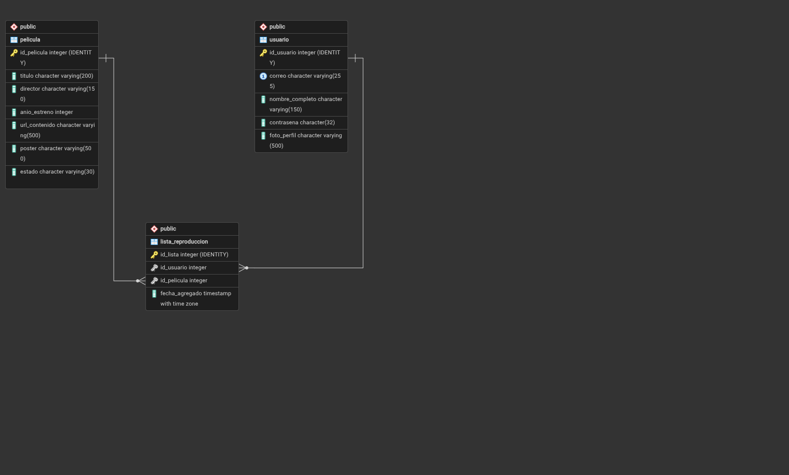

# Práctica 1 - CloudCinema

Este README sirve como **guía rápida de lo que ya quedó configurado** para que el resto del equipo pueda continuar sin perder el contexto.

> **Región usada en AWS:** Ohio (`us-east-2`)  
> **Zona usada actualmente:** `us-east-2b`

---

## 1. Estado actual

Hasta este punto ya se trabajó en:

- Base de datos PostgreSQL.
- Amazon RDS.
- Instancia EC2 para el backend Python.
- Security Groups para backend y RDS.
- Backend Python con FastAPI.
- Registro, login, perfil, películas y lista de reproducción.
- Script SQL y diagrama de la base de datos.

La integración con S3 y otros componentes todavía se realizará después.

---

## 2. Recursos AWS creados

### EC2 Python

| Dato | Valor |
|---|---|
| Nombre | `cloudcinema-python-ec2` |
| ID | `i-0f414b86993572a01` |
| Tipo | `t3.micro` |
| Región | Ohio (`us-east-2`) |
| Zona | `us-east-2b` |
| IP privada | `172.31.21.89` |
| IP pública actual | `3.135.20.86` |
| Security Group | `cloudcinema-backend-sg` |

> La IP pública puede cambiar si la instancia se detiene y vuelve a iniciar, ya que actualmente no tiene Elastic IP.

### RDS PostgreSQL

| Dato | Valor |
|---|---|
| Identificador | `cloudcinema-db` |
| Motor | PostgreSQL |
| Base de datos | `cloudcinema_db` |
| Clase | `db.t4g.micro` |
| Región | Ohio (`us-east-2`) |
| Zona | `us-east-2b` |
| Puerto | `5432` |
| Acceso público | No |
| Endpoint | `cloudcinema-db.clagayom87id.us-east-2.rds.amazonaws.com` |

La EC2 y RDS están dentro de la misma VPC:

```text
vpc-08be89e1cbe2c06bb
```

---

## 3. Security Groups

Esta parte es importante para continuar con la práctica.

### `cloudcinema-backend-sg`

```text
ID: sg-09c5d7268bd13bb60
```

Este Security Group está asociado a la instancia EC2 del backend Python.

Regla de entrada actual:

| Tipo | Protocolo | Puerto | Origen |
|---|---|---:|---|
| SSH | TCP | 22 | `0.0.0.0/0` |

> **Importante:** el acceso SSH desde `0.0.0.0/0` se dejó temporalmente para configuración y pruebas. Antes de la entrega final debe restringirse.

### `cloudcinema-rds-sg`

```text
ID: sg-08b91fc464b60d7f0
```

Este Security Group está asociado a Amazon RDS.

Regla de entrada:

| Tipo | Protocolo | Puerto | Origen |
|---|---|---:|---|
| PostgreSQL | TCP | 5432 | `cloudcinema-backend-sg` |

Esto significa que PostgreSQL **no está abierto directamente a Internet**. Las conexiones al puerto `5432` se permiten desde recursos que utilicen `cloudcinema-backend-sg`.

```text
EC2 Backend
cloudcinema-backend-sg
        |
        | TCP 5432
        v
cloudcinema-rds-sg
        |
        v
PostgreSQL RDS
```

Si otra instancia backend necesita utilizar la misma base de datos, esta configuración debe tomarse en cuenta. **No abrir RDS con `0.0.0.0/0`.**

---

## 4. Base de datos

La base de datos utilizada es PostgreSQL y actualmente contiene tres tablas principales:

- `usuario`
- `pelicula`
- `lista_reproduccion`

Los archivos relacionados están en:

```text
Base-de-Datos/
├── CloudCinema.png
└── cloudcinema_schema.sql
```

El script `cloudcinema_schema.sql` contiene la estructura de la base de datos y puede utilizarse para recrearla.

### Diagrama



La tabla `lista_reproduccion` relaciona usuarios y películas mediante llaves foráneas.

Las contraseñas se almacenan utilizando MD5 porque así lo solicita el enunciado de la práctica.

Las imágenes **no se almacenan como archivos binarios en PostgreSQL**. En la base de datos únicamente se guarda su ruta, por ejemplo:

```text
Fotos_Perfil/usuario.jpg
Fotos_Publicadas/interstellar.jpg
```

---

## 5. API Python

El backend está desarrollado con **FastAPI** y se encuentra en:

```text
API-Python/
```

Estructura principal:

```text
app/
├── movies/
├── playlist/
├── users/
├── config.py
├── database.py
└── main.py
```

### Endpoints actuales

| Método | Endpoint | Uso |
|---|---|---|
| `GET` | `/check` | Comprobar que el backend responde |
| `POST` | `/register` | Registrar usuario |
| `POST` | `/login` | Iniciar sesión |
| `GET` | `/users/{id_usuario}` | Consultar perfil |
| `PATCH` | `/users/{id_usuario}` | Editar perfil |
| `GET` | `/movies` | Listar películas |
| `GET` | `/movies/{id_pelicula}` | Consultar una película |
| `POST` | `/users/{id_usuario}/playlist` | Agregar película a la lista |
| `GET` | `/users/{id_usuario}/playlist` | Consultar lista de reproducción |
| `DELETE` | `/users/{id_usuario}/playlist/{id_pelicula}` | Eliminar película de la lista |

Estos nombres deben mantenerse iguales en el otro backend para conservar un contrato común entre ambas APIs.

---

## 6. Variables de entorno

El archivo real `.env` **no se sube a GitHub**.

En el repositorio únicamente existe:

```text
.env.example
```

Ejemplo para desarrollo local:

```env
DB_HOST=localhost
DB_PORT=5432
DB_NAME=cloudcinema_db
DB_USER=usuario_postgresql
DB_PASSWORD=contraseña_postgresql
```

En EC2 debe crearse un `.env` propio apuntando a RDS:

```env
DB_HOST=cloudcinema-db.clagayom87id.us-east-2.rds.amazonaws.com
DB_PORT=5432
DB_NAME=cloudcinema_db
DB_USER=cloudcinemaadmin
DB_PASSWORD=CONTRASEÑA_REAL_DE_RDS
```

Nunca subir contraseñas, `.env`, Access Keys ni archivos `.pem` al repositorio.

---


