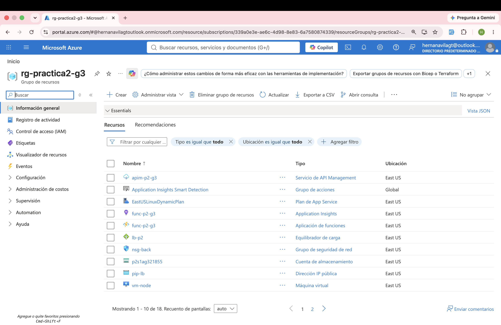
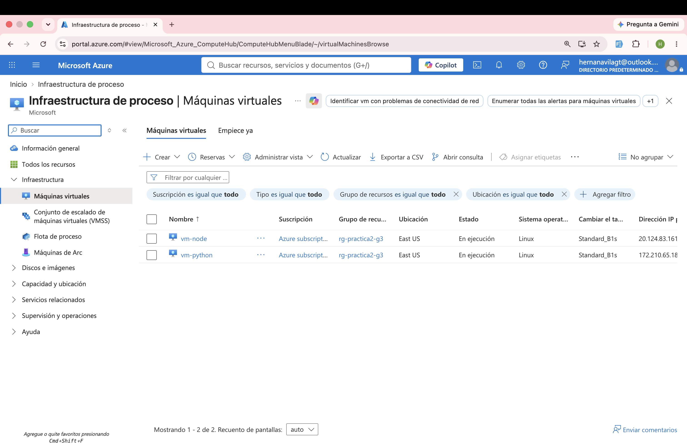
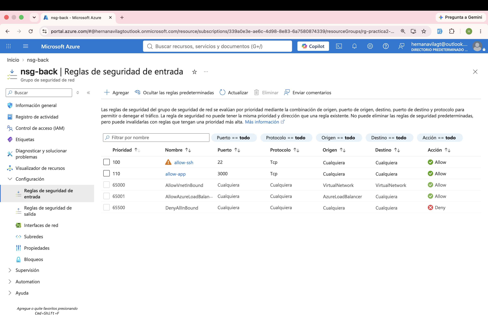
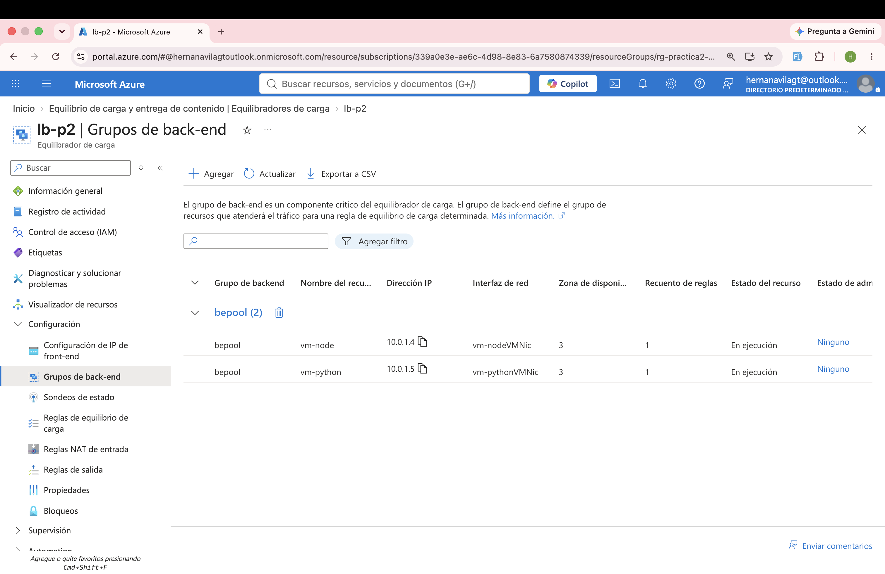
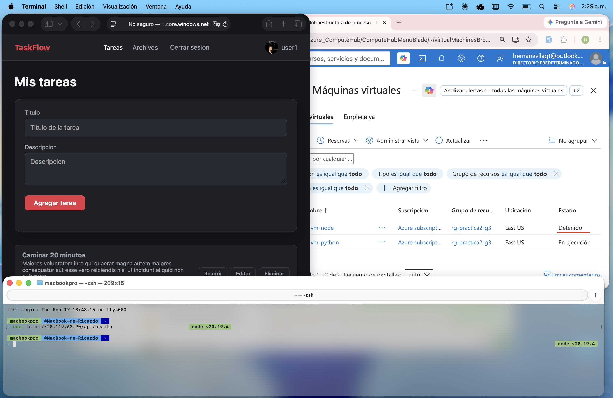
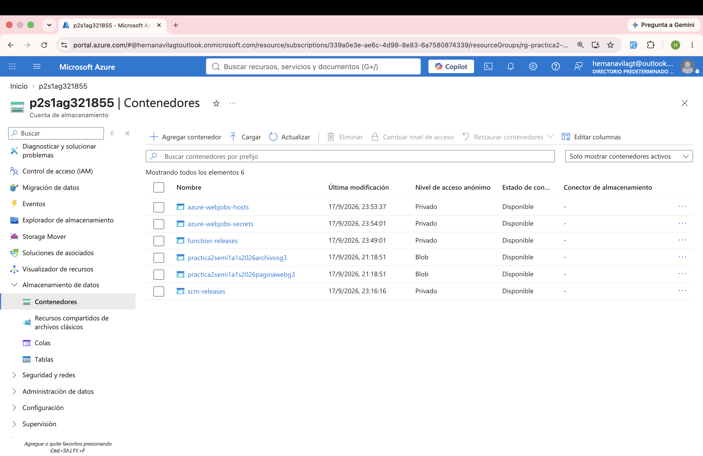
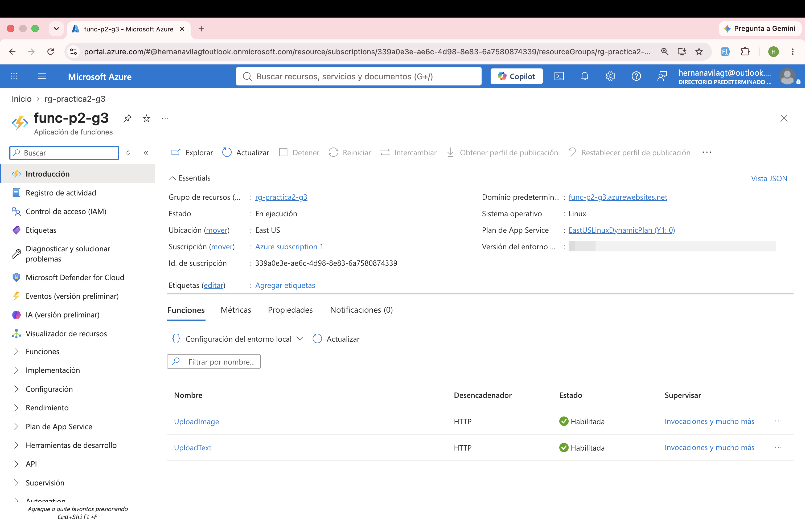
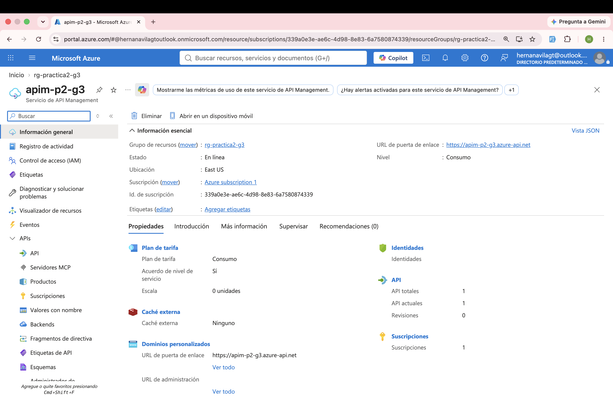

# TaskFlow + CloudDrive — Manual Técnico

Práctica 2 de Seminario 1, Sección A, Grupo 3. TaskFlow + CloudDrive es una
aplicación de gestión de tareas y archivos desplegada completa en AWS y en
Microsoft Azure con backends equivalentes en Node.js y Python.

El detalle del contrato de la API, la configuración de los backends y las
pruebas está en [`Docs/MANUAL-TECNICO-API.md`](Docs/MANUAL-TECNICO-API.md).
Este documento cubre lo que exige el enunciado como manual técnico de entrega.

## Datos de los estudiantes

| Nombre | Carné |
| --- | --- |
| Hernán Ricardo Ávila Castillo | 9516085 |
| Javier Andrés Monterroso García | 202102140 |
| Daved Abshalon Ejcalon Chonay | 202105668 |

<!-- PENDIENTE: confirmar reparto de trabajo si el auxiliar lo pide -->

## Descripción de la arquitectura utilizada

### AWS

<!-- PENDIENTE: companero de AWS -->

Backend Node.js y Python sobre EC2, balanceados con un Elastic Load Balancer,
frontend estático en S3, base de datos en RDS PostgreSQL, y carga de archivos
mediante Lambda expuesto con API Gateway.

### Azure

Dos VMs Ubuntu 22.04 (`Standard_B1s`), una con el backend Node.js y otra con el
backend Python, ambas escuchando en el puerto 3000. Un Azure Load Balancer
Standard reparte el tráfico del puerto 80 hacia las dos VMs y sigue sirviendo
si una de ellas se apaga. El frontend estático y los archivos de los usuarios
se guardan en dos contenedores públicos de una misma Storage Account. La carga
de imágenes y documentos de texto se resuelve con dos Azure Functions
(`UploadImage`, `UploadText`) expuestas a través de Azure API Management. La
base de datos es la misma RDS PostgreSQL de AWS: Azure no monta base de datos
propia, las VMs se conectan directo al RDS compartido.

```text
Usuario -> Storage Blob (web estática)
Storage Blob -> Azure Load Balancer -> Backend Node.js (VM) -> RDS (AWS)
                                     -> Backend Python (VM) -> RDS (AWS)
Storage Blob -> API Management -> Azure Function UploadImage -> Blob (archivos)
                                -> Azure Function UploadText  -> Blob (archivos)
```

## Descripción de los usuarios IAM y sus políticas

<!-- PENDIENTE: companero de AWS -->

## Capturas de pantalla de los recursos

### AWS

<!-- PENDIENTE: companero de AWS -->

#### AWS S3

<!-- CAPTURA: bucket de la web estática y bucket de archivos, ambos con acceso público -->


#### AWS EC2

<!-- CAPTURA: las dos instancias EC2 (Node.js y Python) corriendo -->


#### AWS Load Balancer

<!-- CAPTURA: target group con las dos instancias healthy -->


#### AWS RDS

<!-- CAPTURA: instancia de RDS PostgreSQL disponible -->


#### AWS Lambda

<!-- CAPTURA: las dos funciones Lambda (UploadImage y UploadText) -->


#### AWS API Gateway

<!-- CAPTURA: rutas configuradas para las dos funciones Lambda -->


#### AWS IAM

<!-- CAPTURA: usuario IAM con las políticas asignadas -->


#### Prueba de failover AWS

<!-- CAPTURA: la app respondiendo con una instancia EC2 detenida -->


### Azure

#### Azure Resource Group

<!-- CAPTURA: grupo de recursos completo con todos los servicios -->


#### Azure VM

<!-- CAPTURA: las dos VMs (vm-node y vm-python) en estado Running -->


#### Azure NSG

<!-- CAPTURA: reglas del NSG mostrando los puertos 22 y 3000 abiertos -->


#### Azure Load Balancer

<!-- CAPTURA: frontend IP, backend pool con las dos NICs y el health probe en verde -->


#### Prueba de failover Azure

<!-- CAPTURA: la app respondiendo con vm-node apagada -->


#### Azure Blob Storage

<!-- CAPTURA: los dos contenedores (web y archivos) con acceso público -->


#### Azure Functions

<!-- CAPTURA: Function App con UploadImage y UploadText desplegadas -->


#### Azure API Management

<!-- CAPTURA: las dos operaciones importadas y la policy de CORS -->


## Conclusión sobre las diferencias percibidas entre Azure y AWS

Desplegar la misma aplicación en los dos proveedores deja ver que los servicios
son conceptualmente equivalentes (VM ↔ EC2, Load Balancer ↔ ELB, Blob ↔ S3,
Functions ↔ Lambda, API Management ↔ API Gateway), pero la experiencia de
aprovisionarlos difiere bastante.

La fricción más grande no fue técnica sino de cuenta: una suscripción Azure
Free Trial recién creada no tiene acceso real a capacidad de cómputo durante
un período de verificación, y el error que devuelve (`SkuNotAvailable` por
"restricción de capacidad") no distingue esto de una falta de capacidad real
en la región. Probamos 9 regiones distintas y dos familias de VM antes de
entender que el problema era la cuenta, no la infraestructura; la solución fue
pasar a Pay-As-You-Go. AWS no impuso una restricción equivalente al crear los
recursos de EC2.

Azure CLI (`az`) permite scriptear casi toda la infraestructura —VMs, red,
balanceador, storage, Function App— desde un único script bash, algo muy
similar a lo que ofrece la CLI de AWS. La diferencia notable está en la
calidad de los mensajes de error: varios comandos de `az` devuelven trazas de
Python crudas en lugar de un mensaje claro, lo que hace la depuración más
lenta. Azure API Management, además, no se pudo dejar completamente scriptado:
importar las funciones y configurar la política de CORS requirió pasos
manuales en el portal, mientras que el equivalente en API Gateway suele
resolverse por completo vía CLI o IaC.

También encontramos una diferencia de madurez entre versiones de runtime: el
plan de Consumption de Azure Functions en Linux listaba Node 24 como
soportado, pero desplegar con esa versión dejaba el Function App entero
respondiendo 503; bajar a Node 22 lo resolvió de inmediato. Por lo demás, una
vez sorteadas esas particularidades, ambas nubes lograron el mismo resultado
funcional: dos backends balanceados con failover real, almacenamiento público
para la web y los archivos, y carga de archivos vía funciones serverless.
